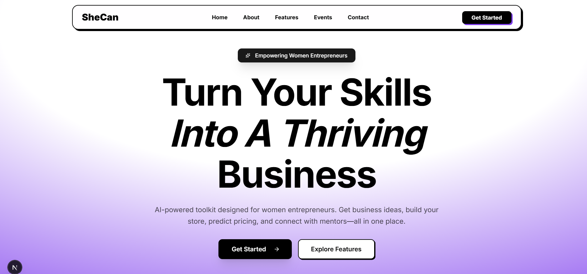
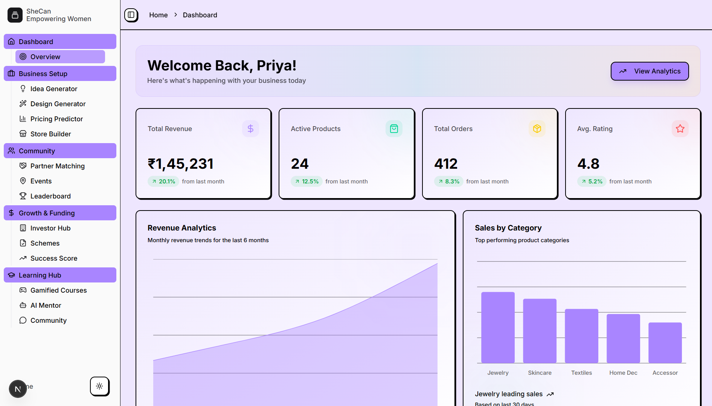
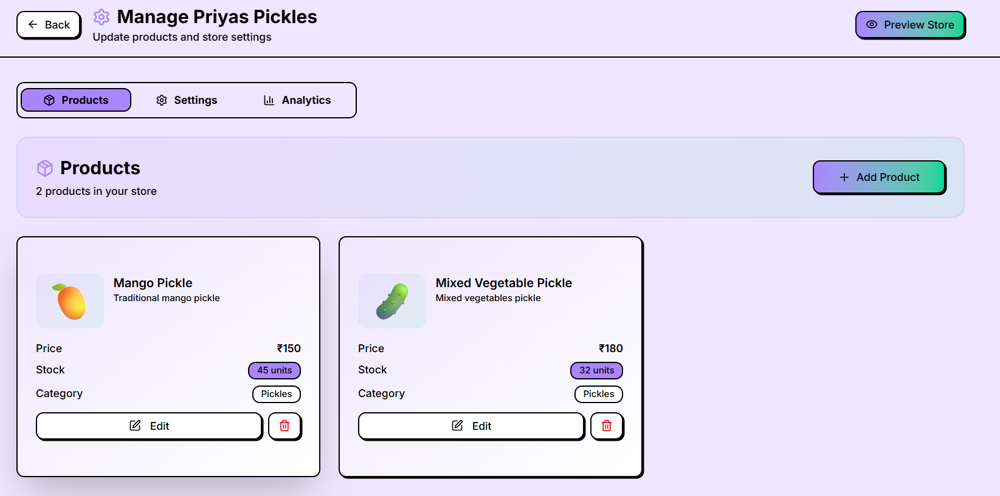
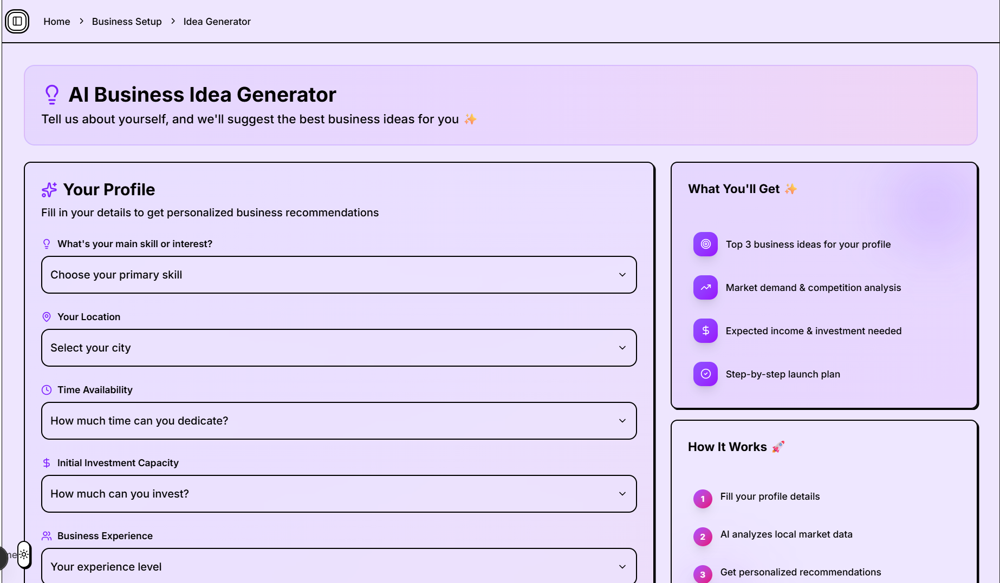
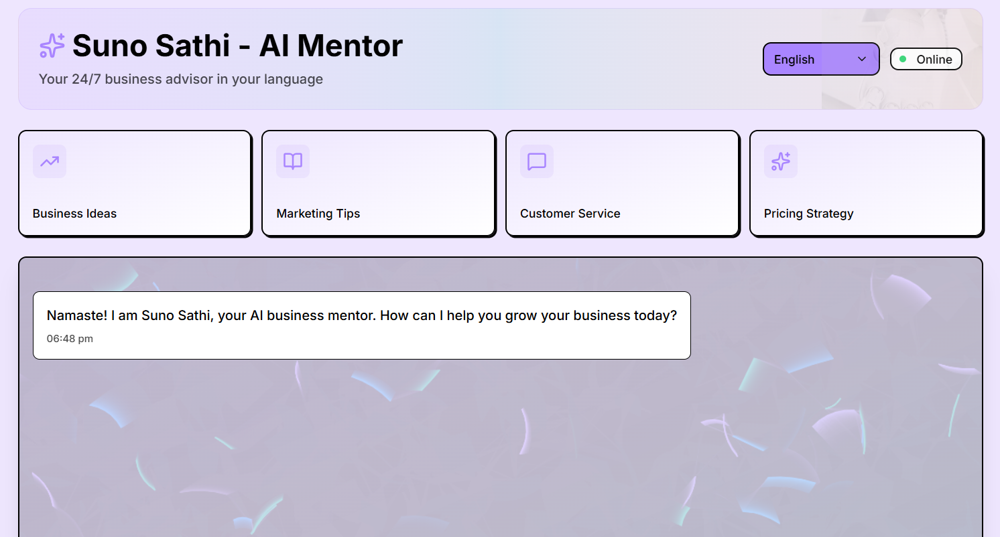

# SheCan — Empowering Women Entrepreneurs

> A full-stack AI-powered platform helping women build, grow, and scale their businesses.

## 📸 Screenshots








## 🔗 Links

- **Notion:** 
- **Demo Video:** 
- **Live Website:** 

## ☁️ Cloudinary Integration

Cloudinary powers all image handling in SheCan, specifically for the **Store Builder** feature where entrepreneurs upload product and store images.

- Images are uploaded from the client via a reusable `ImageUpload` component (`components/image-upload.tsx`) to the `/api/upload` route.
- The route uses the Cloudinary SDK (`lib/cloudinary.ts`) with `cloudinary.uploader.upload` and stores assets under the `shecan/store` folder.
- Returned `secure_url`s are used as product/store imagery and rendered with `next/image` (hostname `res.cloudinary.com` configured in `next.config.ts`).
- Environment variables required:
  - `CLOUDINARY_CLOUD_NAME`
  - `CLOUDINARY_API_KEY`
  - `CLOUDINARY_API_SECRET`

## ✨ Features

- AI-powered design & content generation (Gemini)
- Online store builder with product image uploads
- Learning hub & courses
- Community & partner matching
- Growth & funding tracker
- Investor directory
- Leaderboards & dashboards

## 🛠 Tech Stack

- **Framework:** Next.js 16 (App Router, TypeScript)
- **Styling:** Tailwind CSS v4, shadcn/ui, Radix UI
- **Database:** MongoDB (via Prisma)
- **AI:** Google Gemini (`@google/genai`, `@google/generative-ai`)
- **Media:** Cloudinary
- **Charts:** Recharts
- **Animations:** Framer Motion

## 🚀 Getting Started

```bash
npm install
npm run dev
```

Open http://localhost:3000.

## 🔐 Environment Variables

Create a `.env` file in the project root:

```bash
# Gemini (text, JSON, image generation)
GEMINI_API_KEY=your_gemini_api_key
GEMINI_IMAGE_MODEL=gemini-2.5-flash-image

# MongoDB
DATABASE_URL_1=mongodb://...

# Cloudinary
CLOUDINARY_CLOUD_NAME=your_cloud_name
CLOUDINARY_API_KEY=your_api_key
CLOUDINARY_API_SECRET=your_api_secret
```

## 📁 Project Structure

```
app/          # Next.js routes & API
components/   # UI & dashboard pages
lib/          # Gemini, Cloudinary clients
prisma/       # Schema & migrations
```

## 📄 License

MIT
